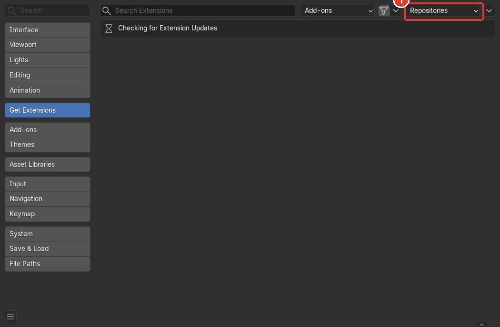
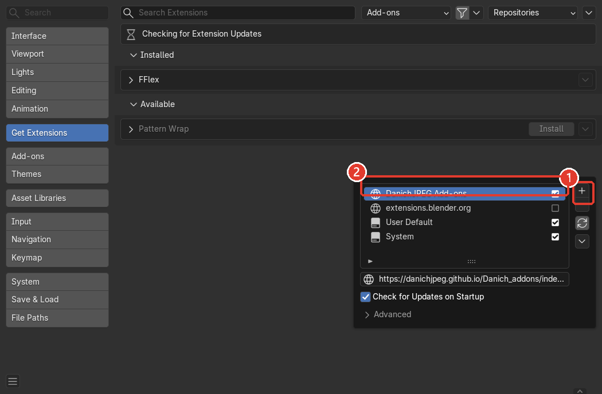
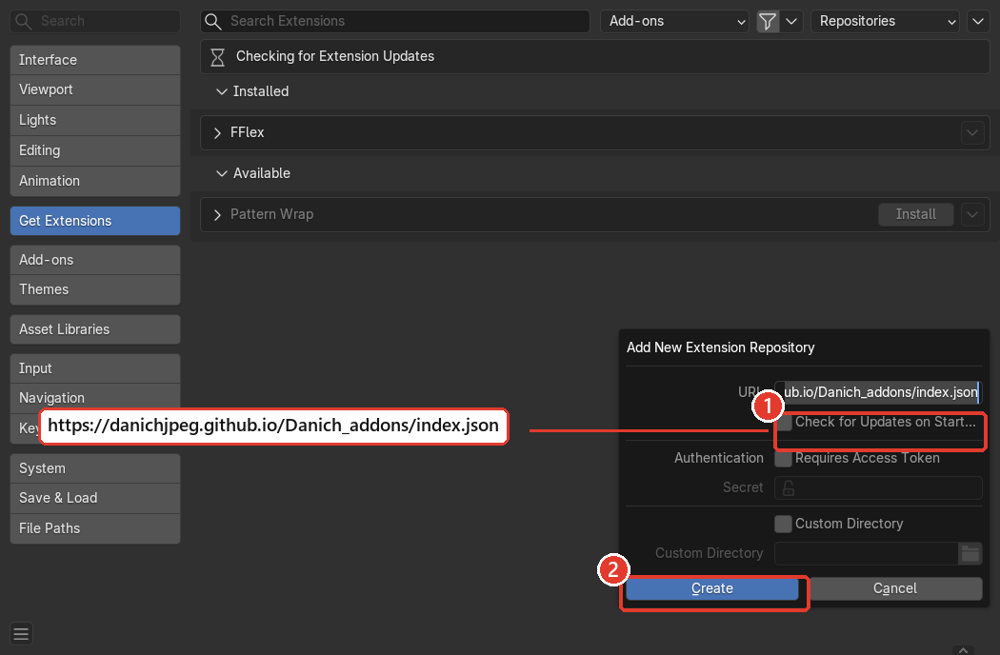
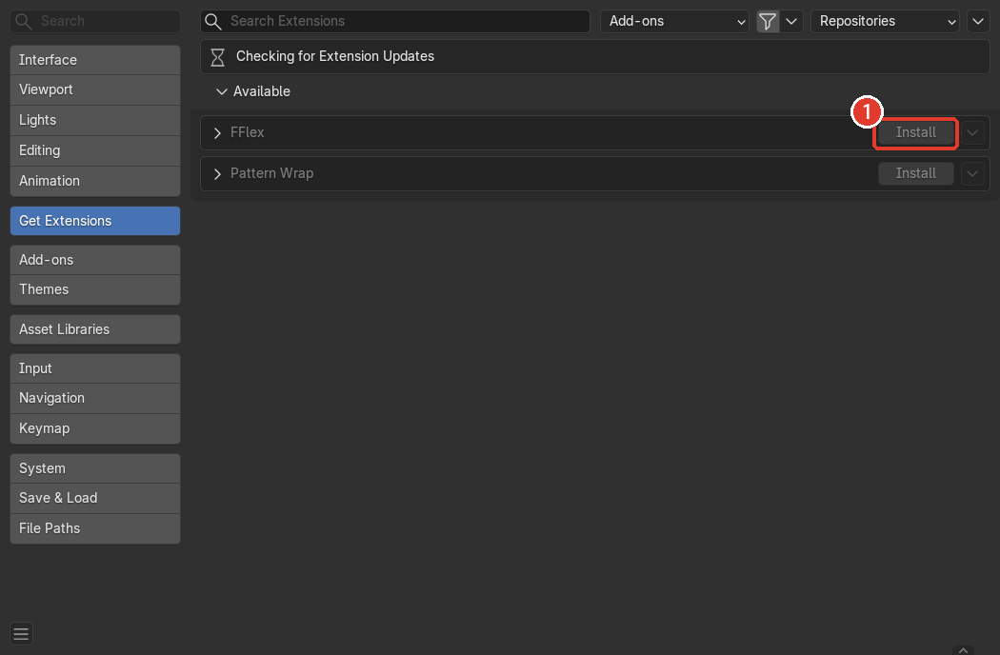
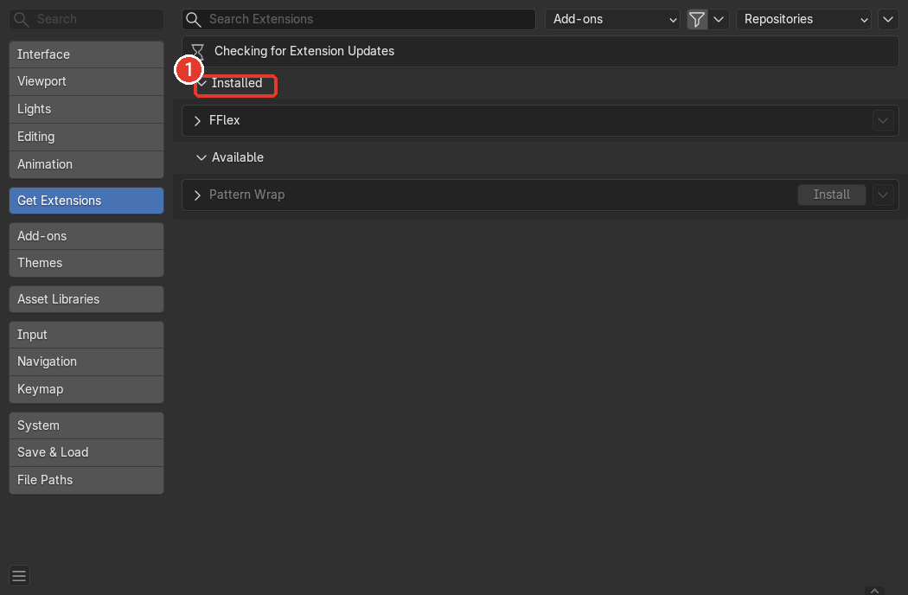
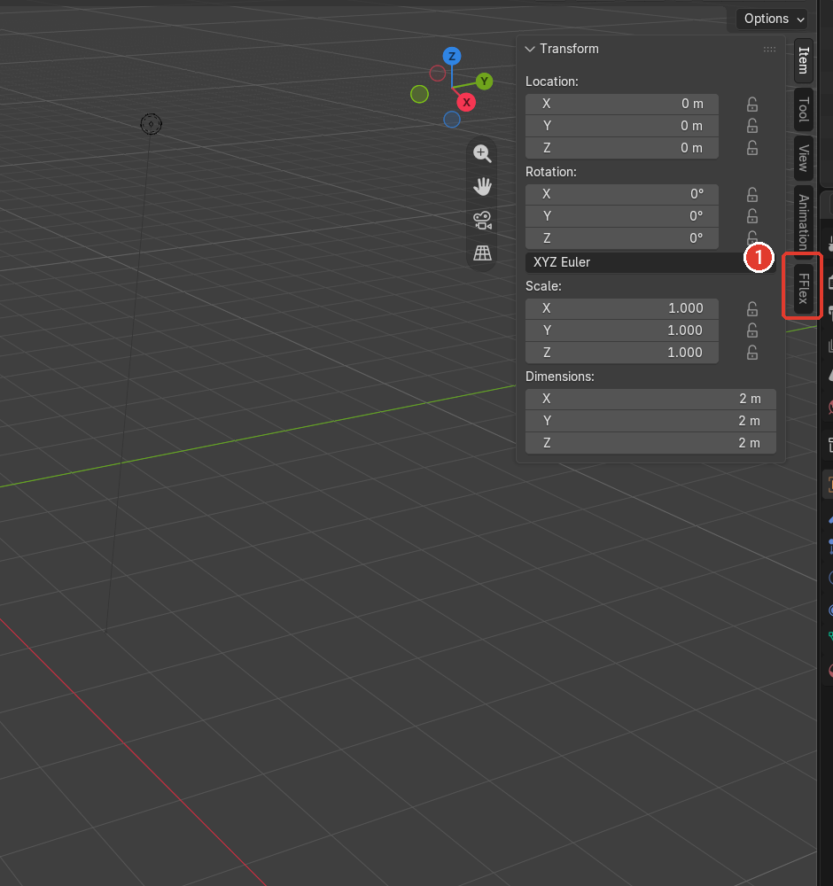
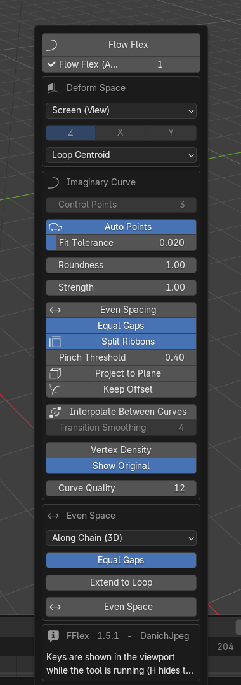

# Как установить аддоны DanichJPEG в Blender

Аддоны раздаются через **удалённую библиотеку (репозиторий расширений)**: один раз
добавляете адрес — дальше Blender сам скачивает аддоны и предлагает обновления.
Работает в Blender **4.5 и новее** (система расширений появилась в 4.2).

**Адрес библиотеки:**

```
https://danichjpeg.github.io/Danich_addons/index.json
```

Скопируйте его целиком — `/index.json` на конце обязателен.

## Что лежит в библиотеке

| Аддон | Для чего |
|---|---|
| **FFlex** | Подгонка петель рёбер по мнимой кривой: экранное пространство, глобальные/локальные оси, равные промежутки. Панель в `3D View → N → FFlex`, горячая клавиша `Ctrl+Shift+F` |
| **Pattern Wrap** | Наложение узорного мэша на деформированный объект: проекция, привязка, UV-развёртка. Панель `3D View → N → Pattern Wrap` |

---

## Шаг 1. Откройте раздел расширений

`Edit → Preferences…` (в главном меню) → в левом списке выберите **Get Extensions**.



## Шаг 2. Добавьте библиотеку

В правом верхнем углу нажмите **Repositories** — откроется список репозиториев
(на картинке цифра **1** — кнопка **+**). Нажмите **+** и выберите
**Add Remote Repository**.



Цифра **2** — так добавленный репозиторий выглядит в списке; ниже показан его адрес.

## Шаг 3. Вставьте адрес и создайте репозиторий

В поле **URL** вставьте адрес библиотеки (цифра **1**), затем нажмите **Create**
(цифра **2**).



Отдельного поля с именем репозитория в Blender 5.x нет — имя подставляется
автоматически по адресу. Галочку **Check for Updates on Startup** можно оставить:
Blender будет сам проверять обновления при запуске.

## Шаг 4. Обновите список и установите аддон

1. Откройте **Repositories** и нажмите кнопку обновления (круговая стрелка) — или
   просто подождите: при включённой галочке список обновляется при запуске.
2. В разделе **Available** появятся `FFlex` и `Pattern Wrap`. Нажмите **Install**
   у нужного аддона (цифра **1**).



Аддон установится и сразу включится — отдельно искать его в Add-ons не нужно.

## Шаг 5. Проверьте, что установилось

Установленные аддоны переезжают в раздел **Installed** (цифра **1**). Здесь же
появятся кнопки **Update** / **Remove**, когда выйдет новая версия.



---

## Где искать аддоны после установки

Панель **FFlex**: в 3D-окне нажмите `N` (боковая панель) и выберите вкладку
**FFlex** (цифра **1**).



Сама панель выглядит так (запуск инструмента — `Ctrl+Shift+F`):



Панель **Pattern Wrap** — там же, вкладка `Pattern Wrap` рядом с `FFlex`.

## Обновления

Blender проверяет их сам при запуске (галочка *Check for Updates on Startup*) или
вручную: **Repositories → ⟳**, затем кнопка **Update** в карточке аддона.
Из консоли:

```bash
blender --background --online-mode --command extension update
```

## Если что-то не получилось

| Симптом | Что делать |
|---|---|
| Список аддонов пуст | Откройте **Repositories** и нажмите кнопку обновления (круговая стрелка) |
| `Archive size mismatch` при установке | Кэш индекса устарел: нажмите обновление и повторите установку |
| Аддона нет в списке | Проверьте, что адрес скопирован целиком, вместе с `/index.json` на конце |
| Blender спрашивает про доступ в интернет | Разрешите: `Preferences → System → Allow Online Access` (без этого синхронизация репозитория не работает) |
| Раньше ставили аддон вручную (zip) | Старую копию надо удалить: `Preferences → Add-ons → FFlex → Remove`, иначе две версии будут конфликтовать |
| Ничего не помогло | Пришлите скриншот раздела **Get Extensions** с открытым списком Repositories |

---

*Скриншоты сделаны в Blender 5.2 LTS. В 4.5 интерфейс выглядит так же; в более
старых сборках в диалоге добавления репозитория может быть дополнительное поле
с именем репозитория — его можно заполнить произвольно.*
